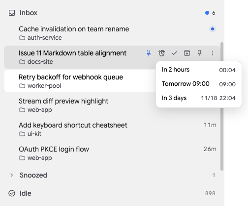
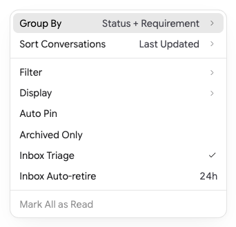

<div align="center">


# Agy Context Dashboard (Antigrative Dashboard)

DSH-style Antigravity (`agy`) context composition, token throughput, cache hit rate, quota pace, and global insights dashboard beside the model selector and inside the companion Side Panel.<br>
Keep the summary visible. Hover or switch tabs for full details.

[](CHANGELOG.md)
[](COMPATIBILITY.md)
[](COMPATIBILITY.md)
[](LICENSE)

[Preview](#preview) · [IDE](#antigravity-ide) · [CLI](#antigravity-cli-status-line) · [Install](#install) · [Enable or remove](#plug-and-unplug) · [Companion Sidebar](#companion-sidebar) · [Host UI Chinese & Acknowledgements](#host-ui-chinese-and-acknowledgements) · [Compatibility](#compatibility) · [FAQ](#faq) · [中文](README.md)

</div>

> [!IMPORTANT]
> **Antigravity Desktop `2.33.0+` / `2.34.0+` Compatibility, Startup & Post-Update Auto-Injection Note (`v0.9.6`, [`#19`](https://github.com/wycocoyu/agy-context-dashboard/issues/19), [`#17`](https://github.com/wycocoyu/agy-context-dashboard/issues/17))**
>
> - **`2.34.0+` CSRF credential migration (`v0.9.6`)**: Antigravity `2.34.0` removes `--csrf_token` from `language_server` command-line arguments and writes `{ pid, httpsPort, httpPort, lsVersion, csrfToken }` into `~/.gemini/<appDataDir>/daemon/*.json`. **`v0.9.6`** automatically falls back to PID-matched, live-port-verified daemon metadata while staying compatible with `<= 2.33.x`. If you saw `"Local metrics credentials are unavailable in this version"` after updating to `2.34.0`, update to `v0.9.6`.
> - **Why `2.33.0+` drops the debugging port**: Starting in Antigravity `2.33.0`, `--remote-debugging-port` is CLI opt-in only and `<profile>/DevToolsActivePort` is deleted when absent; in-app updates (`quitAndInstall()`) also drop CLI flags on restart; and `app.asar` is sealed by `ElectronAsarIntegrity` and Hardened Runtime signing, so this plugin leaves `app.asar` untouched.
> - **Dual recovery in `v0.9.5+` (shortcut self-healing + default-on `autoRelaunchDebug`)**: On Windows (`.lnk`) and Linux (`.desktop`), the dashboard syncs debug flags into user-owned desktop shortcuts automatically; on macOS Dock launches and after in-app `quitAndInstall()` restarts without flags, **`autoRelaunchDebug` stays enabled by default (opt-out)** and triggers only during the **first 20s of sidecar startup** (max 1 auto-relaunch per sidecar, guarded by a **60s sliding window allowing up to 2 distinct-PID relaunches at least 5s apart** plus same-PID dedupe).
> - **Zero-relaunch launcher & opt-out control**: Use the generated debug launcher (`manage.py install --with-launcher`: `~/Applications/Antigravity (Debug).app` on macOS, `%LOCALAPPDATA%\AntigravityPulse\Launch Antigravity (Debug).cmd` on Windows, `~/.local/share/applications/antigravity-pulse-debug.desktop` on Linux) to start with zero extra restarts, or uncheck **Auto-relaunch when debug port is missing** in the official Side Panel (**+ → Extensions → Antigrative Dashboard**) to persist `autoRelaunchDebug: false`.

**v0.9.8:** Introduce the **context composition, session audit & global insights workspace** ([`#16`](https://github.com/wycocoyu/agy-context-dashboard/issues/16), [`#24`](https://github.com/wycocoyu/agy-context-dashboard/issues/24), [`#29`](https://github.com/wycocoyu/agy-context-dashboard/issues/29), [`#34`](https://github.com/wycocoyu/agy-context-dashboard/issues/34), [`#43`](https://github.com/wycocoyu/agy-context-dashboard/issues/43), [`#44`](https://github.com/wycocoyu/agy-context-dashboard/issues/44)): place **Daily/Weekly Activity** and **Usage by Model** first alongside **Session** and **Insights**, add dual-mode host context breakdown, compaction/checkpoint trends, Session Audit (`Files`, `Commands`, `Steps`), public-pricing USD cost estimates, `2.34.0` multi-agent quota rollups + `cacheMissSurges`, opt-in lossless host Simplified Chinese UI, a per-model **Cache hit** column, explicit localized `Cache hit rate:` / `缓存命中率：` hero pills, zero false partial/WAL-retry usage warnings, and 192 MiB ledger heap protection. Retains `v0.9.7` update availability badges, `v0.9.6` `2.34.0+` daemon credential compatibility, `v0.9.5` default-on `autoRelaunchDebug` recovery, `v0.9.2` debug launchers, `Gemini 4` / `GPT-6.1 Sol` / `Claude 4.5–5.5`, macOS `language_server.native` discovery, and `agy 1.5.x` CLI features. [Release notes](https://github.com/wycocoyu/agy-context-dashboard/releases/tag/v0.9.8) · [Changelog](CHANGELOG.md).

## Preview


<table>
<tr><th width="50%">Speed and cache pill (explicit hit rate)</th><th width="50%">Split quota pace & 8-category context breakdown</th></tr>
<tr>
<td width="50%" valign="top"><br></td>
<td width="50%" valign="top"><br></td>
</tr>
</table>

<table>
<tr><th width="50%">Side Panel · Session view (4-tab navigation)</th><th width="50%">Side Panel · Global Insights view</th></tr>
<tr>
<td width="50%" valign="top"></td>
<td width="50%" valign="top"></td>
</tr>
</table>

<table>
<tr><th width="50%">Daily and weekly activity</th><th width="50%">Usage by model (with Cache hit column)</th></tr>
<tr>
<td width="50%"></td>
<td width="50%"></td>
</tr>
</table>

<sub>Desktop widget and Side Panel screenshots rendered directly from current source with illustrative host layouts and data; these are not IDE screenshots. Main and subagent samples use separate statistics; quotas are account-wide. The 44% context sample uses the latest request-start estimate, not cumulative input. Language and Host UI Chinese preferences persist across restarts.</sub>

**Keep working. Everything is in view across input strip and Side Panel.**

| See the speed | Know your quota & context | Global insights & zero noise |
| --- | --- | --- |
| Session decode TPS, E2E speed, TTFT (P50 / Latest), and model/tool times. | Split Gemini, Argon, and 3p Claude quota pace forecasts alongside 8-category host context composition and trend lines. | Daily/Weekly and By model (with per-model Cache hit) first in Side Panel, plus Global Insights, Session Audit, USD cost estimates, and opt-in Host UI Chinese. |

### Small details that matter

- **Token usage, DSH-style.** Compact total tokens and an explicit **Cache hit rate:** hero pill (`缓存命中率：` / `快取命中率：`); hover for uncached input, cache reads, output, optional cache writes, and zero-cache miss surge counts (`cacheMissSurges`).
- **Split quota pace & 8-category context breakdown.** Hover the quota ring for five-hour/weekly balances, reset timers, exhaustion pace forecasts, and sibling groups; hover Context for latest-request occupancy, host 8-category composition (`List`/`Bar`), compaction/checkpoint trends, and Host UI Chinese / language controls.
- **English or Chinese.** English by default, with one-click switching and a saved preference.
- **Language survives restarts.** The inline widget and side panel share an atomic user preference file (`AntigravityPulse/preferences.json`), independent of the host's changing local port.
- **Hover delay and instant transition.** First hover waits 250ms to prevent accidental popups; clicks and keyboard focus open immediately. Moving between metrics stays instant while a card is open or for 350ms after leaving the controls. Leaving early or replacing the conversation/composer cancels a pending popup.
- **Stable menus.** Quota-group menus stay open across polling cycles while countdowns continue ticking.
- **Actual account data.** Remaining quota comes from the account API, not an estimate based on text length. Expired windows do not automatically become 100%.
- **Conversation-aware.** Switch chats without carrying the previous chat's throughput into a new one.
- **Subagent-aware.** Token/cache totals include the selected agent and its reachable descendants, with separate current-agent/subagent contributions. Speed and context describe the selected agent, while quotas remain account-wide. Background collection, request deduplication and saved totals keep nested tasks responsive. [Accounting and limits](docs/USAGE.md#delegated-tasks-boost--teamwork--subagents).
- **Teamwork compatibility (v0.8.1).** Keep the strip through send/stop/cancel transitions and support deeply nested static agent badges. Conversation IDs come from the current input's DOM owner when available, including switches without a URL change. Hidden/inert or deeper editors are ignored; ambiguous visible inputs/badges are not guessed. Six-level English/Chinese browser fixtures pass, including usage remount and context-to-usage language synchronization. Windows real three-level delegation was checked with independent metrics, return navigation and a generating-state screenshot; this host changed its URL at each level and rendered one composer. Same-URL/six-level DOM cases remain fixture coverage; signed-in Linux/macOS GUI checks are still pending.
- **Survives updates.** Plugin-owned runtime attachment reconnects after app updates, without modifying the application archive.
- **Persistent conversations.** TPS and cache statistics are saved separately for each conversation and account; reloads can recover saved statistics.
- **Compact-window support.** Full statistics reduce to four clickable icons (speed, cache, quota and context) when space is limited. Hover or click for details; language switching stays available in the context card. The strip hides only if the icons cannot fit safely and restores when space returns. Message controls hidden behind the composer do not cause scroll flicker.
- **Discoverable language settings.** English is the default. A compact bilingual first-use tip beside context opens the English / 简体中文 / 繁體中文 choices at the bottom of its detail card. The panel and usage window offer the same three choices through their language menu. Preferences survive restarts. Choosing a language or closing the tip saves completion, so it does not return on restart. Closing the tip does not change the language; failed saves offer a retry. Subagent composers do not repeat the tip. Language changes do not change the UTC+8 usage accounting boundaries.
- **Theme adaptation.** Controls, cards and quota menus follow Antigravity's light/dark mode and custom background, card, text and accent colors, with readable text and OS fallback in standalone previews. Live changes require no restart or conversation reload.
- **Local collection.** The collector talks to loopback endpoints. It does not upload your metrics to a third-party service.

## Antigravity IDE

**v0.7.0** adds a separate VSIX for Google's own standalone IDE. Download
`antigrative-dashboard-ide-0.9.8.vsix` from the release and choose **Install from VSIX…**
in the IDE's Extensions view. No desktop App installation is required.

Fully quit the IDE, then start it with
`--remote-debugging-port=0 --remote-debugging-address=127.0.0.1`.
Add these flags to your IDE shortcut for subsequent launches. Narrow panes show
four icons; wider panes show values. Hover/click opens the same metric details.

Windows IDE **2.5.5** and **2.6.0** (`agy --hub` + nested Webview) are supported with automated verification. Linux/macOS IDE
have automated coverage; signed-in GUI acceptance is still outstanding.
VS Code, Visual Studio, JetBrains, Zed and Xcode integrations are not implemented.
See [IDE installation, update, diagnostics and data cleanup](ide/README.md).

## Antigravity CLI status line

Available in **v0.6.0**: an independent adapter for the official Antigravity CLI `statusLine` interface displays context occupancy, cache read tokens, state, normalized model/subagent details (`--details`), and grouped quotas (`Gemini`, `Argon` weekly, and shared `3p` `Claude`), with English/Chinese and terminal-width adaptation. Remaining quota numbers and bars are **green ≥70%, yellow ≥30% and <70%, red <30%**. Preview: `node cli/statusline.mjs --preview`; install: `python manage.py install-cli` (or `python manage.py install --with-cli`; Linux/macOS: `python3`). Requires Node.js 20+ and a CLI supporting the interface. Historical CLI 1.3.2/1.3.3 support covers tested Sonnet 4.6, GPT-OSS 120B, and CLI 1.3.3 Gemini 3.8 Flash (High); CLI 1.5.x support adds current-request cache percentage for verified first-party model families (including `1.5.5` and `1.5.9`) when `cache_creation_input_tokens` is zero (`word/*`, `perplexity/*`, `GPT-6*`, BYOK, unknown placeholders, and nonzero cache-write cases remain unavailable). CLI tok/s needs streaming-duration data absent from the documented payload. See [CLI usage and rollback](docs/CLI.md).


<sub>Historical Linux Antigravity CLI 1.3.3 session after two English replies: current-request cache share 95.7%, 13.1K cached-read tokens; account email masked. macOS signed-in interactive acceptance remains outstanding.</sub>

## Install

### 1-Line Agent Install (Recommended)

No manual commands needed. Paste this single line into Antigravity to auto-detect your host (Desktop App / CLI / Standalone IDE) and install:

```text
Install and enable this Antigravity plugin for me: https://github.com/wycocoyu/agy-context-dashboard
```

For strict step-by-step verification and SHA256 checks, expand the full agent prompt below.

The commands below install the **desktop App adapter**. IDE users should use the [separate VSIX instructions above](#antigravity-ide).

Supported: **Windows, Linux and macOS; Antigravity desktop App (2.21.1 / 2.22.0 and 2.33.0+); Python 3.10+**. The same release ZIP works on all three systems. No third-party pip or npm packages are needed to install or run the plugin. The sidecar uses the app's bundled Node.js runtime. See [COMPATIBILITY.md](COMPATIBILITY.md) for the per-platform verification scope.

> The inline model-row position has no public plugin mounting API. A standard Antigravity sidecar now attaches the widget through the existing local renderer debugging endpoint. Default installation does not modify `resources/app.asar`. This is unofficial; future changes to the host DOM, debugging channel, SDK or metrics API may require an adapter update. The native side panel remains a fallback.

### Antigravity Desktop 2.33.0+ debugging-port requirement

Starting in **Antigravity Desktop 2.33.0**, the host no longer enables the renderer remote debugging port by default and actively deletes `<profile>/DevToolsActivePort` at startup when `--remote-debugging-port` is absent. In addition, normal Dock or shortcut launches—and automatic restart updates via `autoUpdater.quitAndInstall()`—drop CLI flags. Because macOS enforces `ElectronAsarIntegrity` and Hardened Runtime code signing on `app.asar`, the plugin leaves the application archive untouched and instead provides an **opt-in desktop debug launcher** and a **Side Panel relaunch action** passing `--remote-debugging-port=0 --remote-debugging-address=127.0.0.1`:

- Generate the debug launcher during installation with `python3 manage.py install --with-launcher` (use `python` on Windows), or create it anytime with `python3 manage.py install-launcher`.
- Generated debug launcher paths:
  - **macOS**: `~/Applications/Antigravity (Debug).app` (can be pinned to the Dock)
  - **Windows**: `%LOCALAPPDATA%\AntigravityPulse\Launch Antigravity (Debug).cmd`
  - **Linux**: `~/.local/share/applications/antigravity-pulse-debug.desktop`
- You can also launch or relaunch from a terminal via `python3 manage.py launch` (add `--relaunch` to wait for any existing main process to exit before relaunching with debug flags).

Download the ZIP from the [latest release](https://github.com/wycocoyu/agy-context-dashboard/releases/latest), extract it to a permanent folder, or clone the repository:

```powershell
git clone https://github.com/wycocoyu/agy-context-dashboard.git
cd agy-context-dashboard
python manage.py install --with-launcher
```

On Linux / macOS, use `python3 manage.py install --with-launcher` or `sh install.sh` (and `python3` for the lifecycle commands below). Never run the installer with sudo.

On Antigravity 2.33.0+, fully quit and launch via the generated debug launcher (such as `~/Applications/Antigravity (Debug).app` on macOS) or `python3 manage.py launch --relaunch`; on 2.32 and earlier, a regular quit and reopen is enough. Open a conversation: the strip appears beside the model selector. PowerShell users can also run `./install.ps1` (or omit `--with-launcher` when running `python manage.py install`).

The installer copies and enables the plugin and restores any exactly verified legacy patch during migration. The runtime discovers the current renderer port and reconnects automatically. **Keep the extracted source folder** for enable, disable, update, and uninstall commands.

<details>
<summary><strong>Ask an agent to install it</strong></summary>

```text
Install and enable Antigrative Dashboard on this computer.
Repository: https://github.com/wycocoyu/agy-context-dashboard
1. Read README.md, COMPATIBILITY.md, docs/CLI.md and ide/README.md. Inspect the OS,
   available executables, host versions and existing dashboard configuration with
   read-only checks. Distinguish desktop App, Antigravity CLI (agy) and standalone
   Antigravity IDE. The OS alone does not identify the target.
2. Before downloading an installation package or changing settings, summarize the
   detected hosts and ask me to confirm the target: App, CLI or standalone IDE.
   If several are present, let me choose one or more; if none is identified, ask
   for its executable path. Do not guess App when I say Linux or terminal.
3. Fetch the latest stable release metadata and report its plugin version, the
   host version/path and the selected adapter. The App and CLI share a ZIP, but
   their installation commands differ. The standalone IDE uses a separate VSIX.
   Download only assets for the confirmed target and verify SHA256. Keep the
   extracted source in a permanent directory. Do not install the host itself or
   upgrade, downgrade or replace it without separate confirmation.
4. Use Python 3.10+ (python3 on Linux/macOS) and the selected instructions:
   - App: check python manage.py status, then python manage.py install (on
     Antigravity 2.33.0+, pass --with-launcher if a desktop debug launcher is
     wanted and start via that launcher or python3 manage.py launch --relaunch).
   - CLI: check agy --version and Node.js 20+, then python manage.py install-cli.
     Do not run manage.py install. Preserve any existing statusLine using the
     documented backup/override flow. CLI cache percentage is conditional; check
     docs/CLI.md for tested models/versions and unavailable values. Do not claim
     CLI tok/s or local usage charts: they are not available through this adapter.
   - Standalone IDE: install the release VSIX through Install from VSIX... or
     ide/manage.py install --exe <verified-IDE-executable> --vsix <release-VSIX>.
     It does not require the desktop App; do not run the App installer.
5. Preserve unrelated settings and saved data. If a restart or login is needed,
   tell me first and do not forcibly interrupt running tasks. For IDE launches,
   follow its documented loopback debugging flags. For CLI, start a new session.
6. Verify the selected adapter in its real host, and report plugin/host versions,
   target, path, checks actually performed, remaining steps and how to disable or
   uninstall that adapter. Never treat installing a ZIP as proof of CLI success.
```

</details>

## Plug and unplug

### Open the App side panel

Open the right auxiliary pane using its top-right toggle, then choose **+ → Extensions → Antigrative Dashboard** in that pane's toolbar. The Side Panel exposes four top-level tabs ordered for quick access: **Daily/Weekly**, **By model** (with quota pool rollups and per-model **Cache hit** column), **Session** (Speed/Cache/Context cards, `Audit` files/commands/steps viewer, USD cost estimate, multi-agent rollup & `cacheMissSurges`), and **Insights** (Prompt/Flow credits, cross-session totals, 7-day trend, heatmap, and project/skill/tool distributions). A quick `汉` header button toggles lossless host UI Chinese translation live without restarting; clicking metric cards selects details without hiding on pointer departure, and the standalone modal can still be launched from the inline cache card.

If Antigravity Desktop `2.33.0+` was launched from a regular Dock/shortcut icon—or lost CLI flags after an automatic `quitAndInstall()` update restart—the inline strip enters the `missing-debug-port` diagnostic state. The Side Panel stays open and displays:

- **1-click Relaunch with Debug Port**: gracefully quits the host, waits until all old main PIDs exit, and relaunches Antigravity with `--remote-debugging-port=0 --remote-debugging-address=127.0.0.1`.
- **Auto-relaunch toggle (`autoRelaunchDebug`, enabled by default)**: active for inline installs unless unchecked (`autoRelaunchDebug: false` saved in `preferences.json`); when a direct launch or `quitAndInstall()` update restart is missing the debug port during the first `20s` of sidecar boot, it automatically triggers a debug relaunch (up to `2` distinct-PID attempts per `60s` sliding window).

Fully quit and reopen the App after updating plugin code so its collector loads the new modules. A panel that was already open may still be served by the previous collector until restart.

Run these commands from the project directory (use `python3` on Linux / macOS):

| Action | Command | What happens |
| --- | --- | --- |
| Install or update | `python manage.py install` | Copy runtime adapter; preserve other settings and saved statistics; add `--with-launcher` to also create the debug launcher |
| Install debug launcher | `python3 manage.py install-launcher` | Create the platform opt-in debug launcher (`--remote-debugging-port=0 --remote-debugging-address=127.0.0.1`) |
| Remove debug launcher | `python3 manage.py uninstall-launcher` | Verify ownership marker and remove only the plugin-created debug launcher |
| Launch or relaunch in debug mode | `python3 manage.py launch` | Start desktop App with debug flags; add `--relaunch` to quit the old main process first |
| Disable | `python manage.py disable` | Disable the plugin and hide the strip on its next poll |
| Enable | `python manage.py enable` | Start the plugin and show the strip again |
| Inspect | `python manage.py status` | Check installation, enabled state, runtime health, `debugPortAvailable`, `launcher`, and `debugPortHint` |
| Uninstall | `python manage.py uninstall` | Remove this plugin and any owned debug launcher; retain saved statistics and verified legacy backups |

First installation, plugin code updates, and uninstall require a full app restart. Enable and disable do not require reinstalling or rewriting the archive. `./uninstall.ps1` runs the uninstall command.

**Recovery files stay available.** Original archives live in `%LOCALAPPDATA%/AntigravityPulseBackups/<timestamp>/`. Uninstall retains backups and diagnostic logs. If the archive has unknown modifications, the uninstaller refuses to overwrite it.

`python manage.py install --panel-only` disables inline attachment and installs only the sidecar panel. It requires native UI Extensions to be available on the account and does not provide the inline strip.

The stable internal plugin ID remains `antigravity-pulse` for compatibility with earlier installations. The public project name is **Antigrative Dashboard**.

## How the numbers work

| Metric | Definition |
| --- | --- |
| Context window | Latest request-start `estimatedTokensUsed` / `maxContextTokens`; unknown capacity stays unavailable |
| Cache hit | Cached-read tokens divided by uncached input + cache reads + cache writes; token-weighted across requests |
| Token total | Normalized total input plus output tokens, including thinking output |
| Session decode TPS | Sum of total output tokens (including thinking) from qualified requests divided by their total streaming duration |
| Last-request TPS | Total output tokens divided by streaming duration for the latest qualified request; uncertain, short-window or missing timing stays unavailable |
| E2E speed | Total output tokens divided by `(TTFT + streamingDuration)` across qualified requests; reported separately from pure decode TPS |
| TTFT | Time to first streamed/thinking token (not first answer token); shown as session P50 median and latest request |
| Model time | TTFT plus streaming duration across requests |
| Tool time | Union of tool execution intervals; overlapping time counted once |
| Five-hour / weekly remaining | Account-provided `remainingFraction`; not a currency balance |
| Reset countdown | Account-provided `resetTime` minus the current time |

Request metrics update after requests finish, with a poll about every 2.2 seconds. This is not a per-token instantaneous speed meter. Quotas refresh every 60 seconds; countdowns tick every second.
Antigravity normalizes `inputTokens` to uncached input even for Gemini; these are not upstream prompt-token counters. Cache writes are not hits. Compact cards show readable counters and use a dash for unavailable values. Calculation notes, request-coverage counts and inequality prefixes are kept out of the card. Internally, partial/unknown coverage remains tracked: readable sums may omit missing usage and are not a complete account bill; cache hit rate includes only validated input samples, and zero input has no ratio denominator.
Total `outputTokens` (including thinking) pairs directly with `streamingDuration` because `streamingDuration` spans thinking and visible answer streaming together; if total output is omitted, calculation falls back to `thinkingOutputTokens + responseOutputTokens`, then `responseOutputTokens`. Requests without valid timing do not contribute to TPS. Missing or disconnected data is labeled accordingly.

### Timing quality

Very high TPS can occur when output arrives in a batch and the recorded stream lasts only milliseconds. A short receipt window may not represent actual model generation time. The plugin checks timing quality before adding a request to session TPS; it never imposes hardcoded speed ceilings (such as 250 or 600 tok/s) or invents a longer duration.

- **Excluded from TPS:** invalid token scopes, conflicting duplicate request records, multiple differing attempt usages without matching timing, nonfinite rates, and any short-window or low-output sample with `streamingDuration < 1.0s` or `outputTokens < 30` (`short-window`).
- **Additional diagnostics:** tool-only streams under 1 second with TTFT ≥ 2 seconds and TTFT ≥ 20× stream duration (`short-tool-window`), plus short outliers above `max(8 × median, median + 12 × MAD)` of at least five qualified same-model/provider/basis samples (`short-outlier`).
- **Retained samples:** sustained high speeds (`streamingDuration >= 1.0s` and `outputTokens >= 30`) remain eligible and never hit artificial caps. Uncertain or short-window requests still contribute their reported token, cache, and TTFT values; excluding their rate does not delete the request.
- **Display and saved data:** an uncertain latest request shows **Timing uncertain**, without substituting the preceding request's speed. If no samples qualify, TPS is unavailable. Old saved rates await recalculation from the complete local trajectory; token/cache/context data is retained. Reloading does not restore the old unvalidated TPS.

These are conservative checks on host timing summaries, not proof of buffering. The current local API does not expose a chunk timeline, so missing server generation time cannot be reconstructed. The interface keeps the calculation basis concise; filtering rules are documented here. Desktop and standalone IDE share these rules. See [timing policy and limitations](docs/TPS.md), informed by DSH discussions [#7960](https://github.com/deepseek-ai/deepseek-harness/discussions/7960) and [#6129](https://github.com/deepseek-ai/deepseek-harness/discussions/6129).

## Saved conversation statistics

Context occupancy uses the current request's host-reported window. The compact context card shows occupancy, used/total tokens, sampled model and both quota windows with reset times. Duplicate capacity references, unknown compaction fields, diagnostic text estimates and calculation paragraphs stay out of the card. The collector still keeps separate sourced references and conservative optional transcript diagnostics; neither changes the host denominator or billed usage. See [context limits and sources](docs/CONTEXT_LIMITS.md).

Completed-request TPS, cache counts and whitelisted context estimates are saved automatically in `~/.gemini/antigravity/sidecar_data/antigravity-pulse/panel/data/history-v1/<account-hash>/<conversation-id>.json`. Reloading, restarting, updating or reinstalling the plugin preserves them. Empty or regressing backend data cannot erase a useful saved sample. Saved fallbacks show their saved time in the details. A real 0% cache hit remains 0%.

Records contain whitelisted statistics and model/status only; no prompts, titles, emails or credentials. The current account must be authenticated before its saved files are loaded. Already missing timing cannot be reconstructed. To backfill all conversations still available from the local API and check restart restoration, run `node tools/check-live-history.mjs` with Antigravity open.

## Long conversations

Statistics use separate step and generator-metadata offset reads, with messages disabled for generator requests. Large text/tool payloads are streamed and discarded; updates re-read mutable tails instead of the entire conversation. The former 512 MiB response cap is removed, while projected statistics retain a measured engineering memory budget. See [collection policy, experiments and limits](docs/LONG_CONVERSATIONS.md).

## Local Token usage

Open the **Daily/Weekly** or **By model** top-level tab in the Side Panel, or open the cache/database icon and click **View token usage**. Today and this month share a two-column summary; Activity shows daily/weekly contribution grids; Usage details shows model stacks by day, week or month, quota pool rollup pills (`Gemini` / `Claude / 3p` / `Local`), and a per-model table adding **Cache hit** (`cachedTokens / totalInput`). Large JSON-only ledgers offload automatically to the disk worker under the 192 MiB sidecar heap cap, and false partial/WAL-retry warnings on empty metadata or SQLite WAL locks have been eliminated. Chart colors follow your actual theme and accent; K/M/B summaries use at most one decimal, while tables/tooltips retain full counts.

The first-use introduction explains history import, coverage and privacy. **Got it** saves completion across restarts, language changes and theme changes. Closing the window without acknowledgment keeps the tip for next time; a failed save can be retried.

Opening **View token usage** or clicking its top-right **Refresh usage** button requests historical synchronization. Ordinary polling, card refreshes and quota resets do not start a history scan. Each import consumes a stable, bounded queue in short slices; new top-level conversations wait for the next requested pass, and unreadable or over-budget records leave coverage partial. New completed requests from the current conversation are still recorded during normal polling. The local `usage-v1` ledger deduplicates requests per account and keeps only time, model, Token counters and hashed identifiers; no prompts, replies or credentials. Desktop and IDE have separate ledgers. Deleting a chat does not subtract usage already recorded. This is observed local usage, not a provider bill; missing/deleted historical data may leave gaps. Days/months use UTC+8 and weeks start Monday.

Desktop: `~/.gemini/antigravity/sidecar_data/antigravity-pulse/panel/data/usage-v1/` (the host may override the data directory). IDE: `User/globalStorage/you-should-know-me.antigrative-dashboard-ide/usage-v1/` under its profile. Stop the plugin before deleting its ledger; available conversations can be imported again by opening the usage window after restart. `history-v1` remains the separate latest-per-conversation statistics store. [Accounting, cleanup and limitations](docs/USAGE.md).

## Companion Sidebar

Pair this dashboard with [`wycocoyu/agy-project-sidebar`](https://github.com/wycocoyu/agy-project-sidebar) if you manage many concurrent conversations in Antigravity Desktop:

<table>
<tr><th width="58%">Inbox / Follow-up / Snooze Triage</th><th width="42%">Native Display Options Menu</th></tr>
<tr>
<td width="58%" valign="top"></td>
<td width="42%" valign="top"></td>
</tr>
</table>

- **Ordered Multi-Select `Group By`**: Extends Antigravity's native `Display Options -> Group By` menu with a `Requirement` dimension (e.g., `Status + Requirement`, `Project + Requirement`) and nested collapsible hierarchy sections without adding extra sidebar toolbars.
- **Inbox Triage (`Inbox` / `Follow-up` / `Snooze` / `24h` Auto-retire)**: Decouples opening a thread (`Unread`) from finishing it (`Settle`), includes hover actions with `5s` Undo, and keeps ongoing follow-ups or snoozed tasks organized above `Idle`.
- **Clean Coexistence**: Runs as an independent user-space Sidecar + CDP plugin (`~/.gemini/config/plugins/agy-project-sidebar/`), never modifies host Antigravity installation bundles, and runs smoothly alongside `agy-context-dashboard`.

```bash
git clone https://github.com/wycocoyu/agy-project-sidebar.git
cd agy-project-sidebar
python3 manage.py install
```

## Host UI Chinese and Acknowledgements

The Side Panel `汉` toggle and the inline Context Card **Host UI Chinese** switch enable or disable live **Simplified Chinese localization for the Antigravity Desktop host UI** without patching `app.asar` or restarting the app (using CDP DOM matching + `WeakMap` original-text restoration so turning it off restores exact upstream English strings). Theme skins, font overrides, and sidebar layout rewrites are intentionally excluded, while inline model-selector anchors and user project names are protected from accidental translation.

The built-in dictionary ([`compat/host-i18n-dict.json`](compat/host-i18n-dict.json)) adapts and merges audited entries from three **MIT-licensed** open-source community localization projects:

- [`yiheng8023/antigravity-chinese`](https://github.com/yiheng8023/antigravity-chinese) (MIT): Modular 2.34.0 core dictionary, dynamic regex patterns, and user-content boundaries
- [`antigravity-cn-community/Antigravity-Chinese-Localization`](https://github.com/antigravity-cn-community/Antigravity-Chinese-Localization) (MIT): Desktop settings phrasing, remote sessions, and model/thinking effort badges
- [`ruxiayu/antigravity-zh-cn`](https://github.com/ruxiayu/antigravity-zh-cn) (MIT): Context-scoped entries (`New`, `Low`/`Medium`/`High`) and split DOM text-node handling

## Compatibility

Desktop verified on **Windows 11 / Antigravity App 2.21.1 and 2.22.0**, including real context readings and the combined hover card. A separate VSIX supports standalone Antigravity IDE 2.5.5 and 2.6.0 on Windows. Other editor extensions and DSH are unsupported. Linux/macOS have automated checks; full signed-in desktop/IDE GUI verification is still open. See COMPATIBILITY.md.
Repository presentation is inspired by [DSH Rail Music](https://github.com/YOU-SHOULD-KNOW-ME/dsh-rail-music); installation APIs differ. `dsh plugin add` cannot install this project.

[Full compatibility and recovery details →](COMPATIBILITY.md)

### Language

Open context details and choose **English / 简体中文 / 繁體中文** at the bottom. The first-use bilingual tip points to this setting. The desktop adapter saves an atomic user preference shared with its side panel; the IDE saves its own preference in extension global storage. Both survive restarts. This changes dashboard labels, not the host app or model name.

## FAQ

<details><summary><strong>The strip did not appear after installation.</strong></summary>

Fully quit the main app process and reopen it. Run `python3 manage.py status` (use `python` on Windows) and inspect `debugPortAvailable`, `inlineIntegration`, and `debugPortHint`. On Antigravity 2.33.0+, if it reports `missing-debug-port`, reopen via the launcher created by `python3 manage.py install-launcher` (e.g., `~/Applications/Antigravity (Debug).app` on macOS), run `python3 manage.py launch --relaunch`, or click the 1-click relaunch button inside **+ → Extensions → Antigrative Dashboard**. Also inspect `~/.gemini/antigravity/sidecar_data/antigravity-pulse/panel/logs/sidecar.log` and `data/integration-state.json`. Review raw host logs for local information before publishing them.

</details>

<details><summary><strong>Why is TPS missing in a new conversation?</strong></summary>

There are no request metrics yet. TPS is hidden instead of showing the previous chat's speed. It appears after a model response finishes.

</details>

<details><summary><strong>Why do Gemini, Argon, and Claude have different quotas?</strong></summary>

The service returns independent quota groups: `Gemini`, dedicated `Argon` weekly buckets when reported, and the shared `3p` group (shown uniformly as `Claude`). The default follows the selected model. Inspect another group from a quota card; an explicit label prevents confusion after manually selecting a different group.

</details>

<details><summary><strong>What happens after an Antigravity update?</strong></summary>

App updates cannot overwrite the runtime adapter in the user plugin directory. On 2.32 and earlier, it rediscovers ports, credentials and the renderer automatically. On **Antigravity 2.33.0+**, in-app updates restart via `autoUpdater.quitAndInstall()`, which drops `--remote-debugging-port=0 --remote-debugging-address=127.0.0.1`: starting in `v0.9.5`, the sidecar self-heals Windows/Linux shortcuts and `autoRelaunchDebug` is enabled by default for inline installs (`20s` startup window, single-shot per sidecar, `2` distinct-PID tries per `60s` sliding guard) so the app automatically relaunches once with debug flags and reattaches. If you turn `autoRelaunchDebug` off in the Side Panel (**+ → Extensions → Antigrative Dashboard**), you can still recover via the 1-click relaunch button, `python3 manage.py launch --relaunch`, or the generated debug launcher. If the inline strip is missing, inspect `python3 manage.py status`; use the native panel while a changed host interface is adapted. Never copy an old app archive over a newer installation. See [robustness analysis](docs/ROBUSTNESS.md).

</details>

## Development and releases

```powershell
npm test
python -m unittest discover -s tests -v
python manage.py package
```

ZIP and SHA256 files are generated in `dist/`. Packaging uses an allowlist and excludes credentials, account settings, logs, SDK caches, and application archives.
Generating README images is an optional developer task: `node tools/build-readme-assets.mjs` requires Playwright (or an absolute `PLAYWRIGHT_MODULE` path). It renders the actual widget code with illustrative metrics and produces English/Chinese assets. This is not an installation dependency.

[Development guide →](docs/DEVELOPMENT.md) · [Changelog →](CHANGELOG.md)

## License

Source is available under [MIT](LICENSE). Antigravity binaries, SDK resources, and application backups are not distributed. Product names belong to their respective owners; this project is not affiliated with or endorsed by Antigravity.

## Manual App updates

Open **context details → bottom-right Check for updates**. The App-only updater checks stable official Releases after a click, verifies the archive and checksum, preserves settings/usage, and offers plugin reload after installation. Installation failures retain rollback/recovery material. IDE/CLI packages are installed separately. See [verification, recovery and limitations](docs/UPDATES.md).

---

> **Community Continuation Fork:** This repository (**`agy-context-dashboard`**) continues maintaining **Antigrative Dashboard** (`antigravity-pulse`) under the original [MIT License](LICENSE) starting from `v0.8.12`, after the original upstream repository (`YOU-SHOULD-KNOW-ME/antigrative-dashboard`) went offline (404). Existing user settings, `history-v1`, `usage-v1`, and IDE storage identities remain unchanged.
>
> **Companion Sidebar Plugin:** If you also want multi-select `Group By` (such as `Status + Requirement`) and a decoupled **Inbox / Follow-up / Snooze / 24h Auto-retire** workflow in Antigravity's left conversation sidebar, check out [`wycocoyu/agy-project-sidebar`](https://github.com/wycocoyu/agy-project-sidebar). It uses the same non-invasive Sidecar + CDP architecture and coexists cleanly alongside this dashboard.

